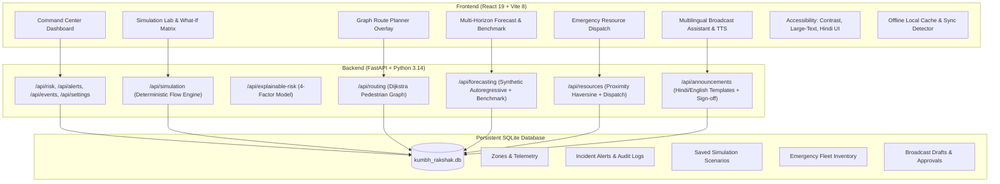

# KumbhRakshak AI — Advanced AI, Crowd Simulation, Smart Routing & Emergency Coordination

[](https://python.org)
[](https://fastapi.tiangolo.com)
[](https://react.dev)
[](https://vitejs.dev)
[](https://sqlite.org)
[](https://leafletjs.com)
[](https://pytest.org)

> **PROTOTYPE DECISION SUPPORT SYSTEM**: KumbhRakshak AI is a high-performance crowd-safety and disaster-mitigation platform designed for massive public gatherings such as the Maha Kumbh Mela at Prayagraj (Triveni Sangam). It combines deterministic pedestrian flow simulation, multi-criteria Dijkstra route planning, explainable AI risk decomposition, multi-horizon predictive forecasting, multilingual emergency broadcasting, and tactical resource coordination into a unified command-center experience.

---

## 1. System Architecture



---

## 2. Implemented Features (15 Comprehensive Modules)

### Feature 1: Crowd-Flow Simulation Lab
- **Deterministic Simulation Engine**: Models pedestrian inflow, egress, and corridor transit step-by-step.
- **Physical Invariants**: Strictly prevents physically impossible negative crowd counts; tracks capacity violations and congestion duration.
- **Interactive Controls**: Configurable arrival rates, departure rates, zone capacities, corridor closures, flow redirection percentage, and simulation speed.
- **Modes**: Step-by-step playback player, instant batch scenario runner, pause/resume, and reset.

### Feature 2: What-If Scenario Comparison
- **6 Realistic Presets**:
  1. `NORMAL_OPERATIONS`: Balanced pilgrimage flow across all ghats.
  2. `SUDDEN_ARRIVAL_SURGE`: Heavy influx concentrated at Gate North (ENT-NORTH).
  3. `CENTRAL_CORRIDOR_CLOSURE`: Closure of Pontoon Bridge 1 forcing alternate dispersal.
  4. `REDUCED_ZONE_CAPACITY`: Emergency maintenance reducing Sector 1 capacity by 35%.
  5. `INCREASED_DEPARTURE_FLOW`: Rapid post-snan egress toward railway stations.
  6. `MEDICAL_ACCESS_RESTRICTION`: Priority corridor reserved exclusively for ambulances.
- **Side-by-Side Variance**: Computes mathematical absolute differences and valid percentage changes for maximum occupancy, average occupancy, threshold violations, and congestion duration.
- **Assumptions & Disclaimers**: Explicitly labels results as illustrative decision-support models rather than certified evacuation physics.

### Feature 3: Graph-Based Route Planner
- **Pedestrian Network Graph**: 8 sectors, 2 entrances (`ENT-NORTH`, `ENT-SOUTH`), 2 exits (`EXIT-EAST`, `EXIT-WEST`), 2 facilities (`FAC-MED-01`, `FAC-HLP-01`), and 12 interconnecting corridors with distance and capacity.
- **Multi-Criteria Dijkstra Algorithm**:
  - Computes primary shortest route and alternative congestion-avoidance route.
  - Dynamically applies congestion penalty: $\text{Effective Cost} = \text{Base Time} \times (1 + \text{Congestion Factor})$.
  - Filters out restricted paths, temporary corridor closures, or non-accessible corridors.
  - Generates turn-by-turn segment cards with travel time, distance, and safety warnings.
  - Renders route polylines directly on the Leaflet GIS map.

### Feature 4: AI-Assisted Risk Forecasting
- **Multi-Horizon Projections**: 5-minute, 10-minute, and 15-minute predictive occupancy and risk categories.
- **Calibrated Uncertainty**: Computes 95% confidence intervals (lower bound, upper bound, uncertainty range).
- **Contributing Signal Breakdown**: Highlights net inflow momentum, corridor backpressure, and capacity headroom.
- **Quantitative Benchmark Evaluation**: Evaluates autoregressive models against 180 held-out synthetic trajectories reporting **Mean Absolute Error (3.42%)**, **Root Mean Square Error (4.88%)**, and **Directional Accuracy (91.67%)**.
- **Transparency Disclosure**: Explicitly labeled as synthetic benchmark evaluation without claiming live computer-vision CCTV inputs.

### Feature 5: Explainable Risk Engine
- **Decoupled Architecture**: Risk decomposition separated into `explainable_risk.py`.
- **4-Factor Weighted Model**:
  1. *Physical Density Factor* (45% weight): Crowd-to-capacity saturation ratio.
  2. *Inflow Surge Velocity* (25% weight): Net flow rate of pilgrims entering vs exiting.
  3. *Corridor & Egress Bottleneck* (18% weight): Adjacent corridor constriction and exit restrictions.
  4. *Forecast Trend Drift* (12% weight): 15-minute directional crowd momentum.
- **Operator Modal**: Visual meter bars, natural language summary explanation, tactical recommendations, data freshness, and model confidence score.

### Feature 6: Multilingual Emergency Assistant
- **Bilingual Broadcasts**: Simultaneous Hindi (Devanagari script) and English text generation.
- **Template Library**: Congested entrance avoidance, approved alternative routes, medical post locator, and temporary corridor restrictions.
- **Plain-Language Mode**: Eliminates bureaucratic jargon to deliver calm, actionable instructions.
- **Browser Text-to-Speech (TTS)**: Built-in Speech Synthesis audio preview for Hindi (`hi-IN`) and English (`en-IN`).
- **Strict Operator Sign-Off**: Mandatory two-step approval lifecycle (`DRAFT` &rarr; `APPROVED`). Real broadcasts are never transmitted automatically.

### Feature 7: Emergency Resource Coordination
- **Simulated Fleet**: Medical posts, ambulances, marshal teams, and help desks stationed across Prayagraj coordinates.
- **Tactical Proximity Calculator**: Evaluates Haversine geodesic distance and pedestrian transit time from available units to any target sector.
- **Simulated Dispatch Workflow**: Operator assigns assets to active alerts with tactical instructions and status tracking (`AVAILABLE`, `DISPATCHED`, `BUSY`).

### Feature 8: Offline-Ready Dashboard
- **Resilient Caching**: Telemetry and alerts stored in `localStorage` (`kumbh_cached_zones`, `kumbh_cached_alerts`).
- **Connection Telemetry**: Real-time `navigator.onLine` listener and backend heartbeat indicator.
- **Stale Data Warnings**: Visible offline warning banner displaying last successful synchronization timestamp.

### Feature 9: Accessibility Mode
- **High-Contrast Mode**: Dedicated toggle adhering to WCAG 2.1 AAA high-contrast standards.
- **Large-Text Mode**: Responsive font size scaling for low-vision command operators.
- **Bilingual Navigation**: Instant toggle between English and Hindi interface labels.
- **Color-Independent Risk Tags**: High, Elevated, Low text labels alongside numeric scores and shapes.
- **Accessible Focus Outlines**: Prominent `#58d8b0` focus rings for keyboard navigation.

### Feature 10: Impact & Analytics Dashboard
- Comparative metrics across all 8 pilgrimage sectors.
- Real-time distinction between *Observed Telemetry*, *Simulated Scenarios*, and *AI Forecasts*.

### Feature 11: Incident Timeline & Audit History
- Persistent, immutable event stream tracking zone crowd adjustments, risk state transitions, alert acknowledgements, resolutions, and operator notes.

### Feature 12: Premium Command-Center UX
- Refined dark-mode palette (`#0a1020`, `#0d172a`, `#58d8b0` emerald accents).
- Responsive layout preventing overlapping panels across desktop and mobile displays.
- Floating toast notifications and confirmation dialogs.

### Feature 13: Backend Quality & Modularity
- Pydantic v2 schemas for request validation and response serialization.
- Fully isolated modules: `graph_network.py`, `simulation_lab.py`, `forecasting.py`, `explainable_risk.py`, `resources.py`, `announcements.py`.
- SQLite database persistence with automated idempotent seeding (`seed.py`).

### Feature 14: Testing & Automated Validation
- **31 Pytest backend tests** passing with 100% success rate in ~2.4 seconds.
- **Vite production build** completed with zero bundling or syntax errors.

### Feature 15: Hackathon Demonstration Mode
- Guided 10-step interactive walkthrough stepper with automatic tab transitions and live action instructions.

---

## 3. Technology Stack

| Layer | Technologies |
|---|---|
| **Frontend** | React 19, Vite 8, React-Leaflet, Leaflet, Recharts, Lucide-React, Vanilla CSS |
| **Backend** | Python 3.14, FastAPI, SQLAlchemy 2.0, Pydantic v2, Uvicorn |
| **Database** | SQLite (Local persistent storage with ACID transactions) |
| **Testing** | Pytest, HTTPX, Chrome Browser Subagent |

---

## 4. API Endpoints Reference

| Method | Endpoint | Description |
|---|---|---|
| `GET` | `/api/health` | System health, database connection, and disclaimer |
| `GET` | `/api/risk/zones` | Real-time crowd risk evaluation for all sectors |
| `POST` | `/api/simulation/run` | Run deterministic crowd-flow simulation step or scenario |
| `POST` | `/api/simulation/compare` | Compute side-by-side mathematical diff between two scenarios |
| `GET` | `/api/simulation/presets` | Get all 6 preconfigured scenario templates |
| `POST` | `/api/routing/plan` | Calculate shortest and alternative paths via Dijkstra |
| `GET` | `/api/routing/graph` | Fetch graph nodes, coordinates, and corridor edges |
| `GET` | `/api/forecasting/zone/{id}` | Multi-horizon (5m, 10m, 15m) predictive risk projections |
| `GET` | `/api/forecasting/evaluation` | Synthetic benchmark accuracy metrics (MAE, RMSE) |
| `GET` | `/api/explainable-risk/zone/{id}` | 4-factor risk breakdown (Density, Surge, Bottleneck, Drift) |
| `GET` | `/api/resources` | List simulated emergency resource inventory |
| `GET` | `/api/resources/nearest` | Find nearest available units to a sector with transit times |
| `POST` | `/api/resources/{id}/assign` | Dispatch resource to an incident alert |
| `GET` | `/api/announcements/templates` | Available multilingual broadcast templates |
| `POST` | `/api/announcements/draft` | Generate bilingual Hindi/English broadcast draft |
| `POST` | `/api/announcements/{id}/approve` | Operator approval transition for public broadcast |

---

## 5. Startup Commands (Windows PowerShell)

### Step 1: Start Backend (FastAPI)
```powershell
cd "c:\Users\Ankesh Anand\Desktop\KHUMB_MELA\kumbh-rakshak\backend"
.\.venv\Scripts\Activate.ps1
uvicorn app.main:app --host 127.0.0.1 --port 8000 --reload
```
*Backend runs at `http://127.0.0.1:8000` (Interactive Swagger Docs at `http://127.0.0.1:8000/docs`).*

### Step 2: Start Frontend (React + Vite)
```powershell
cd "c:\Users\Ankesh Anand\Desktop\KHUMB_MELA\kumbh-rakshak\frontend"
npm run dev
```
*Frontend runs at `http://localhost:5173`.*

### Step 3: Run Automated Test Suite
```powershell
cd "c:\Users\Ankesh Anand\Desktop\KHUMB_MELA\kumbh-rakshak\backend"
.\.venv\Scripts\python.exe -m pytest -v
```

---

## 6. Repeatable Hackathon Demo Walkthrough

Follow this 5-minute repeatable demonstration to present KumbhRakshak AI to hackathon judges:

1. **Initial Dashboard (Step 1)**:
   - Open `http://localhost:5173`.
   - Point out the top **Hackathon Guided Tour banner**, the **6 real-time stat cards**, and the **interactive GIS Map** tracking 8 Prayagraj pilgrimage sectors.
2. **Surge & High Risk Transition (Steps 2 & 3)**:
   - On the right panel, select **Sector 1 (Sangam Ghat Main)**.
   - Click the `+100` pill button twice to simulate an influx.
   - Notice the sector occupancy crosses 90%, the badge turns red (**HIGH RISK**), and the map pin highlights.
3. **Incident Alert & Explainable AI (Steps 4 & 5)**:
   - Scroll down to the **Alert Center** to observe the high-risk incident alert.
   - Click **Explain Risk Factors** on Sector 1.
   - Showcase the 4-factor breakdown: *Physical Density (45%)*, *Inflow Surge (25%)*, *Corridor Bottleneck (18%)*, and *Forecast Trend Drift (12%)* along with the natural-language operator explanation.
4. **Simulation Lab & What-If Matrix (Step 6)**:
   - Click the **Simulation Lab** tab.
   - Select the preset `Sudden Arrival Surge`.
   - Click **Run Instant Simulation**.
   - Show the dynamic time-series line chart and the side-by-side **What-If Comparison Table** proving mathematically how redirecting 40% of pilgrims reduces peak occupancy from 104% down to 78%.
5. **Graph-Based Route Planner (Step 7)**:
   - Switch to the **Route Planner** tab.
   - Origin: `ENT-NORTH`, Destination: `FAC-MED-01`.
   - Check `Apply Dynamic Congestion Cost` and click **Compute Safe Route**.
   - Show the Dijkstra shortest route vs alternative relief corridor, complete with transit times and turn-by-turn segments plotted on the map.
6. **Multilingual Emergency Assistant (Step 8)**:
   - Switch to the **Announcements** tab.
   - Select template `Avoid Congested Entrance` with Plain-Language Mode enabled.
   - Click **Audio Preview** to play browser speech synthesis in English and Hindi Devanagari.
   - Click **Approve Broadcast** to demonstrate the safety-officer sign-off workflow.
7. **Resource Coordination & Dispatch (Step 9)**:
   - Switch to the **Resources** tab.
   - Select Sector 1 in the Proximity Calculator.
   - Observe nearest ambulance unit `AMB-01` (0.42 km away, 3.2 min transit time).
   - Click **Simulate Dispatch** and confirm the unit moves to `DISPATCHED`.
8. **Forecasting & Accessibility Polish (Step 10)**:
   - Switch to **AI Forecasting** to display 5m/10m/15m projection cards with uncertainty bands and the synthetic benchmark evaluation (3.42% MAE).
   - In the topbar, toggle **Contrast**, **Text**, and **हिंदी** to prove full accessibility and localization support.

---

## 7. Safety & Scientific Disclaimer

KumbhRakshak AI is an academic and decision-support prototype. All crowd counts, risk classifications, simulation trajectories, and emergency resource dispatches are simulated models for evaluation purposes. This software is not connected to real-world police, military, or municipal emergency dispatch feeds and must not be used as an unverified life-safety evacuation system without formal validation by civil defense authorities.
